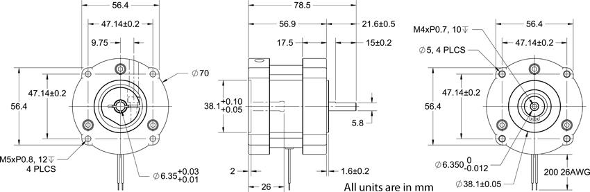
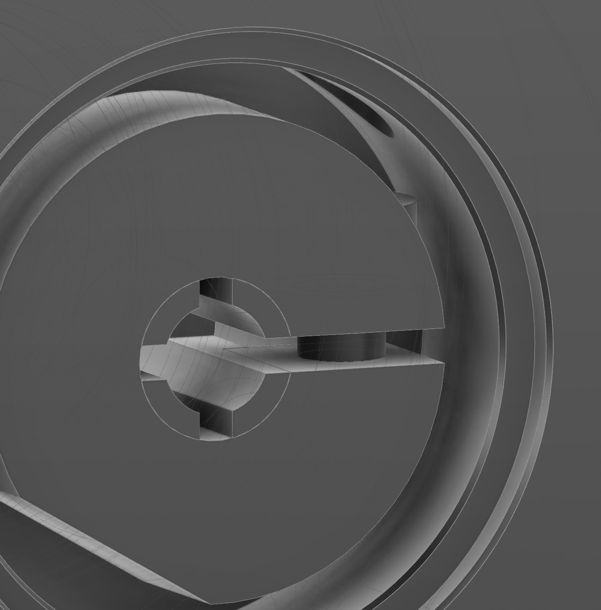
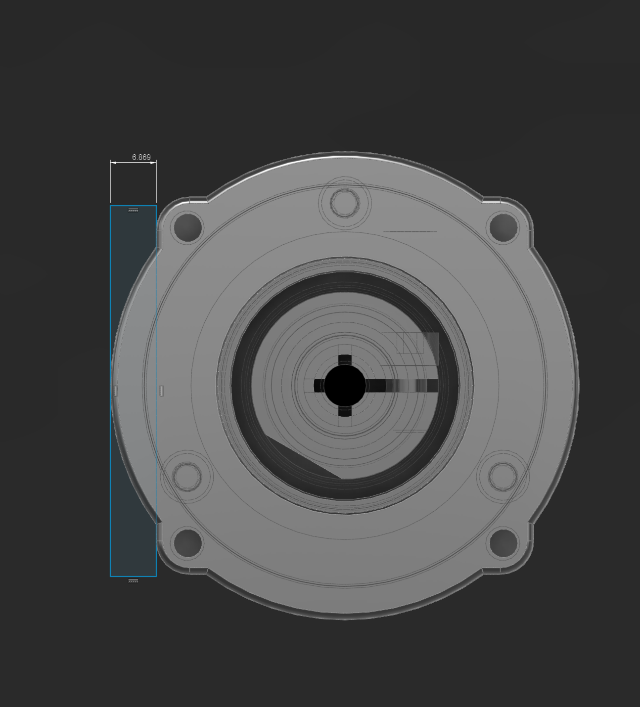
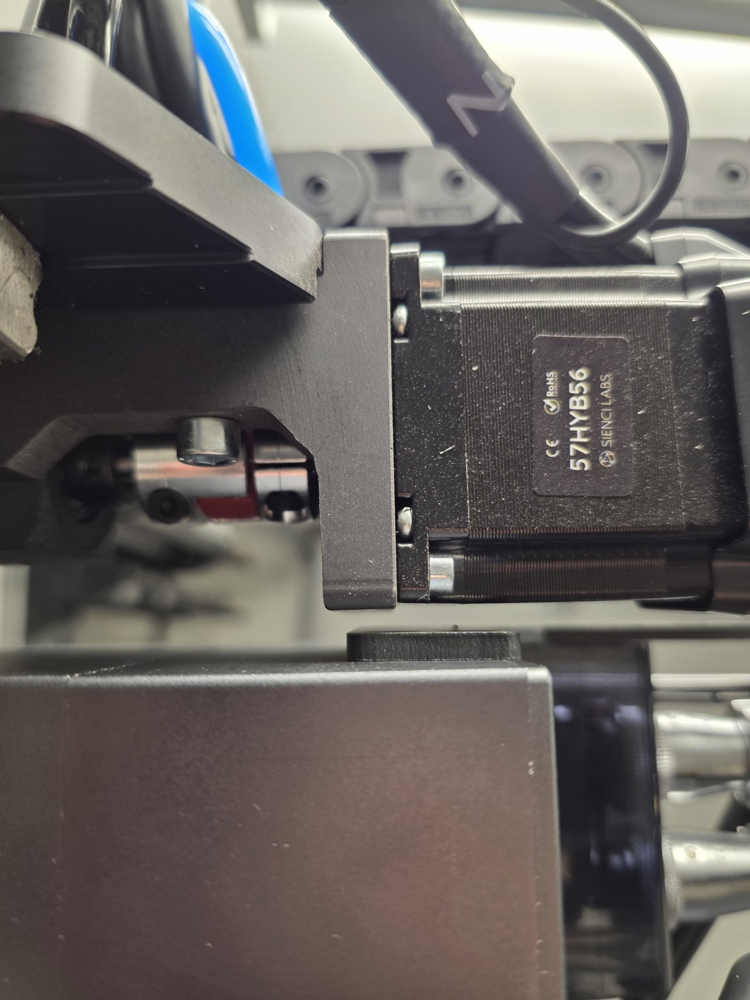
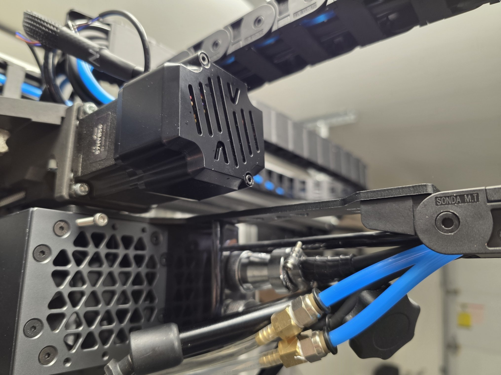

# Z-Axis Power-Off Brake (planned — brake on backorder)

**Status (2026-10-12):** brake ordered, ~85-day lead time (expected early January 2027).
Fit checked in CAD; one interference found and a fix planned. Nothing installed yet.

## The problem

With the ATC spindle fitted, the Z axis **drops when motor power is cut** — E-stop,
power-off, or a driver fault. The spindle's weight back-drives the ball screw. The
closed-loop stepper holds fine while it's powered; the problem is the unpowered case.

A gas spring was the first idea. It was never built: it needs its own bracket, it
rattles, and it's heavy and bulky on the Z. It also only *reduces* the load — it
doesn't hold position. A spring-applied, electrically-released ("power-off") brake
holds the axis with no power at all, and it lives inside the motor stack instead of
hanging off the side of the machine.

## The part

**Anaheim Automation BRK-SB060-035-024-AA231-250** — inline power-off brake, NEMA 23
pattern on both ends. It bolts to the motor bracket where the motor was, and the motor
bolts on top of it.

| Spec | Value |
| --- | --- |
| Holding torque | 354 oz-in (22.1 in-lb, ≈2.5 N·m) |
| Coil | 24 VDC, 650 mA, 12.5 W — **energized to release**, so it's on the whole time the machine runs and runs warm by design |
| Input (motor side) | Ø6.35 mm bore (+0.03/+0.01) with set screw at the front of the hub; Ø38.1 pilot recess 2 mm deep; M5×0.8 tapped 12 mm deep ×4 |
| Output (bracket side) | Ø6.35 mm shaft (0/−0.012) × 21.6 mm with 15 mm flat; Ø38.1 pilot boss 1.6 mm |
| Body | 56.9 mm input face → output face; housing **Ø70 round** |
| Weight / rating | 1.82 lb, IP23 |
| Price | $265 list (2026-10-12) |

Torque margin is huge: the stock 2 N·m motor can't overpower the brake, and the
spindle back-drives the screw at well under 0.5 N·m.

## Fit check (CAD)

- The AltMill Z motor is a **Sienci 57HYB56** (NEMA 23 closed-loop): **6.35 mm shaft,
  18 mm long**. The ball-screw end is 8 mm. The existing 6.35→8 mm coupler goes
  straight onto the brake's 6.35 mm output shaft — nothing to rebore, no coupler to buy.
- The set screw sits right at the front of the hub, so 18 mm of shaft reaches it
  easily. **Check that it lands on the shaft's flat** — stock NEMA 23 flats run ~15 mm
  back from the tip, leaving ~3 mm of round shaft at the flange end, and the hub sits
  down inside the 2 mm pilot recess. If it misses, spot-drill a dimple where the cone
  lands. This joint carries the full motor torque, so Loctite it.
- The stack grows by 56.9 mm. The motor's cable has to reach that much higher.

## Interference (found on the machine)

The housing is Ø70 round on a 56.4 mm square motor, so on each flat the brake sticks
out **6.87 mm further than the motor's face** does.

- Clears the ATC spindle by ~1.5 mm.
- **Hits the Z cable-chain mounting plate.** The plate rides with the spindle, so the
  collision is at the top of travel.

**Fix:** move the chain anchor instead of the brake. The top of the ATC spindle's fan
housing has six shallow **M4** tapped holes. A new bracket there picks up the chain end
and can double as a coolant-hose guide.

Bracket notes:

- Use all six holes. Screw length = bracket thickness + hole depth − 0.5 mm, Loctite
  243, ~1–1.5 N·m (back off to ~1 N·m if the holes are under 4 mm deep).
- Don't cover the fan grill — that's the spindle's cooling path. Keep the bracket on
  the perimeter where the screws are.
- Aluminum for the anchor (cyclic load next to a warm spindle); the hose guide can be
  printed (ASA-CF). Keep the pneumatic lines' bend radius generous.
- Moving the anchor changes the chain's loop, so check closest approach to the brake at
  the top of Z travel — it needs 7 mm from the motor flank's line.
- Worst case: replace the fan grill with a custom grill + chain adapter, matching or
  beating the original open area.

## Wiring plan (at install)

- Release the brake from a relay or MOSFET keyed off the **motor power rail or driver
  enable** — not the controller's logic rail unless it's rated for 650 mA continuous.
  Flyback diode across the coil.
- Wired that way the brake releases a few tens of ms after the drives energize (before
  any motion is possible) and clamps the instant motor power drops — E-stop, PSU, or
  breaker.
- The brake is on the fixed side with the motor, so its two leads route with the Z motor
  cable, not through the Z cable chain.
- The housing clocks in 90° steps on the bolt pattern; orient the lead exit toward the
  chain and away from the ATC.

## Until the brake arrives

Park Z at the bottom of travel before powering off, so a drop has nowhere to go. The
closed-loop motor's holding torque covers it while the machine is on.

## Open items

1. Measure the M4 hole depth on the fan housing; design and cut the chain-anchor bracket.
2. Jog Z end to end and confirm nothing on the ATC passes within 7 mm of the motor flank.
3. Confirm the set screw lands on the motor shaft flat (dimple if not).
4. Pick the controller signal / relay for brake release.

## Sources

- [Anaheim Automation BRK-SB060-035-024-AA231-250](https://anaheimautomation.com/brk-sb060-035-024-aa231-250.html)
- [BRK-SB060 series spec sheet (PDF)](https://anaheimautomation.com/media/anaheim/files/manuals/accessories/L012009_-_BRK-SB060_Series_Spec_Sheet.pdf)
- [Sienci forum — "Altmill z-brake?"](https://forum.sienci.com/t/altmill-z-brake/15408)
